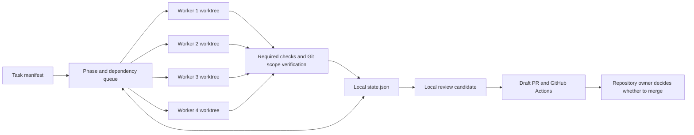

# Local development orchestrator

The orchestrator is a foreground maintenance tool for HookGuard contributors. It uses the current Git commit as a fixed base and keeps work in local branches. It needs Node.js, Git, and the workspace's pinned pnpm. Model-backed runs also need a local Codex CLI with ChatGPT sign-in.

## Phase 1

The [execution gates](plan/14_EXECUTION_PHASES_AND_GATES.md) place the TypeScript workspace, engineering checks, and community templates in Phase 1. Those foundations are in [draft PR #1](https://github.com/BommepalliRoop/hookguard/pull/1). The [Phase 1 manifest](../orchestrator/phase-1.json) schedules four follow-up tasks against that foundation. Each owns a separate set of files and has an independent check command. The full [60-task backlog](plan/04_PROJECT_DELIVERY_BACKLOG.md) remains the source for subsequent manifests.



## Run or resume

From the repository root, install the lockfile and start the controller in a terminal. Use a dedicated state directory outside the checkout, on the same host. The confirmation flag is for a ChatGPT account with zero purchased credits and automatic reload disabled. Check the account settings before passing it. The controller verifies ChatGPT sign-in, strips API-key environment variables, and selects the first available configured model for each role.

```powershell
pnpm install --frozen-lockfile
$runPath = Join-Path (Split-Path (Get-Location).Path -Parent) 'HookGuard-phase1-run'
pnpm run orchestrate run --state-dir $runPath --confirm-no-paid-usage
pnpm run orchestrate status --state-dir $runPath
pnpm run orchestrate review --state-dir $runPath
```

The controller emits JSON lines. A `worker_started` event includes the process ID, model, owner, worktree, and branch. The state file records the base SHA, configuration digest, task state, current owner, attempts, actual command exit codes and durations, and verified result commits. `review` prepares a separate local candidate and verifies lint, formatting, type checks, build, and the coverage suite. The GitHub workflow runs those checks on a draft PR alongside the offline integration and security tests.

Use `--codex-bin` on `run` to select a standalone Codex executable. Native Windows runs can also select an available sandbox implementation with `--windows-sandbox elevated` or `--windows-sandbox unelevated`. The workspace-write policy applies in both cases. [Codex configuration basics](https://learn.chatgpt.com/docs/config-file/config-basic)

Use the same manifest and state directory to resume. Completed tasks retain their commits. A stale lock or interrupted running task requires `--recover` after checking that its processes have exited. An active owner or different host prevents recovery. Each attempt gets a fresh worktree. Failed worktrees are retained for diagnosis. Create a new state directory to run a revised manifest. Use `--record-transcripts` only if needed for local diagnosis and keep those files private.

## Scheduling and boundaries

- Tasks have IDs, phases, prerequisite IDs, repository-relative file scopes, a model role, a prompt, and required checks. The controller dispatches only tasks in the earliest unfinished phase whose prerequisites succeeded. Overlapping path scopes never run concurrently. Declare dependencies for tasks that intentionally change the same files.
- Slots have one owner at a time. Four is the maximum. Each model process and check has a wall-clock and output limit. Transient failures have bounded retries and backoff. Usage-limit, invalid work, and failed verification are surfaced in the checkpoint.
- The controller checks worker changes before and after running verification. It requires an implementation or configuration change and an automated test change, rejects out-of-scope paths and unsupported Git file types, and commits verified changes on the attempt branch.
- Git worktrees isolate edits and history. Local test commands still execute using the host user's permissions. Review task prompts and commands before running them. Codex subprocesses request workspace-write mode with approval and network access disabled for model shell commands. CI uses local test subprocesses without model login.
- The terminal and host must stay active. Sleep pauses local progress, and a crash may require recovery. The controller prepares local branches and a candidate for review. Remote pushes and draft PR creation are owner-authorized steps, and merging requires a separate owner decision.
